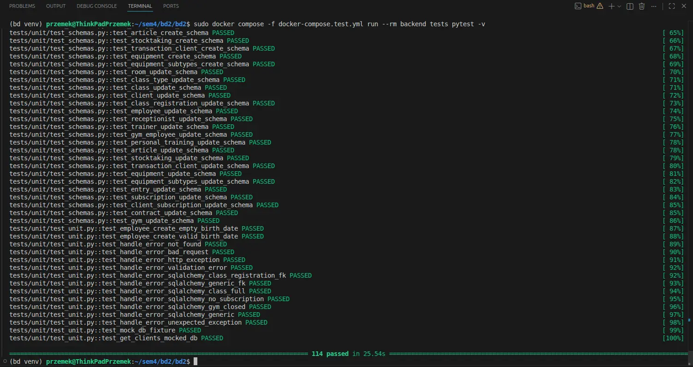
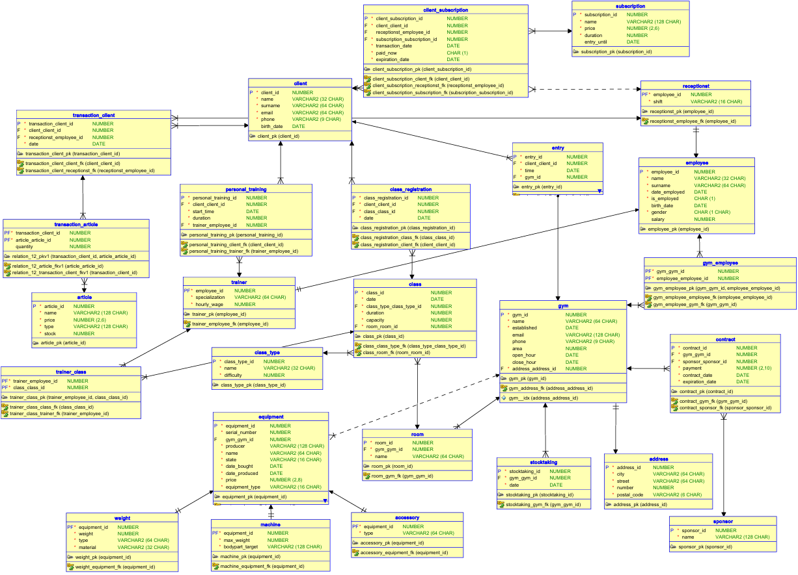
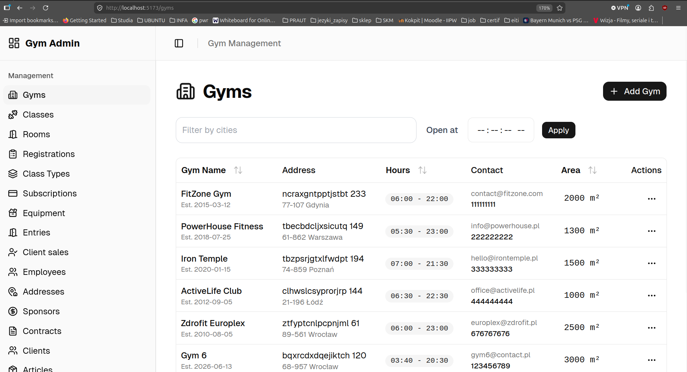
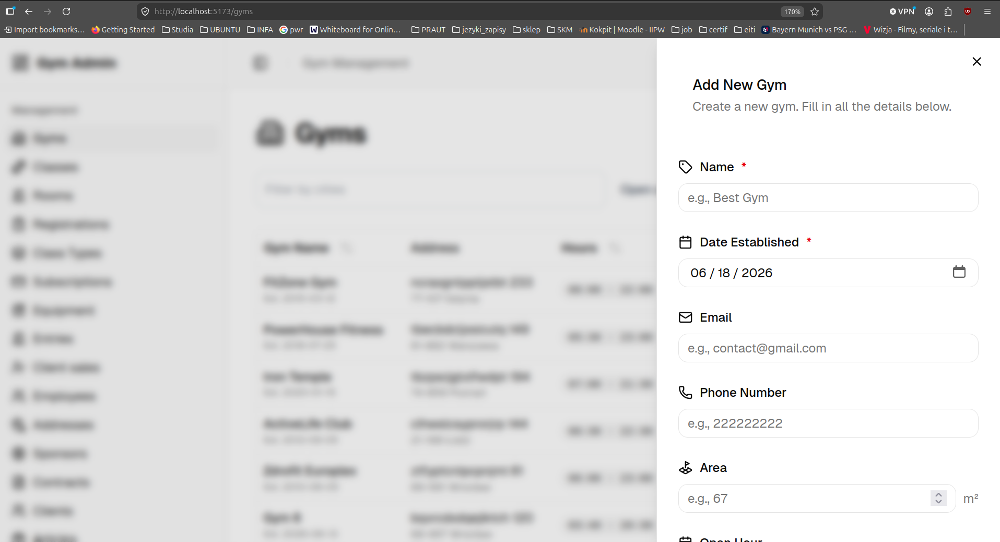
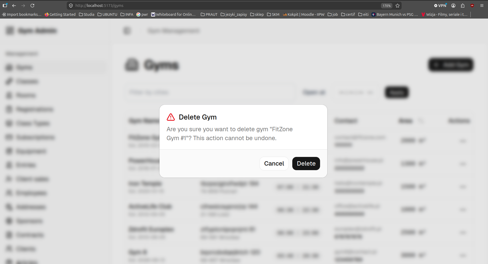
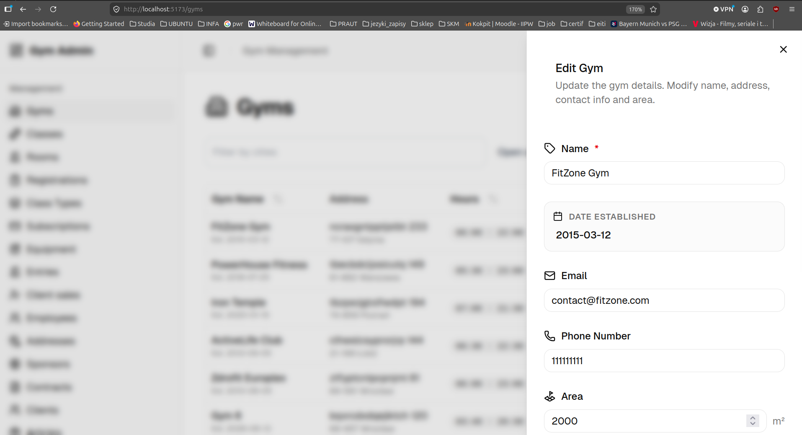
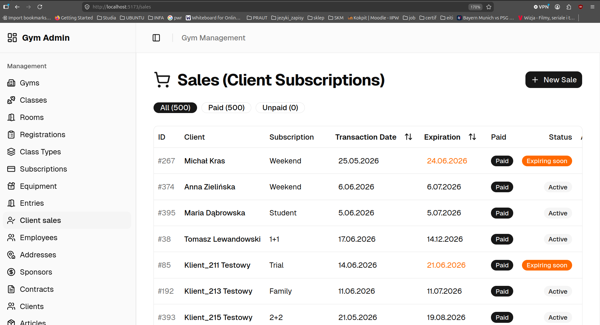
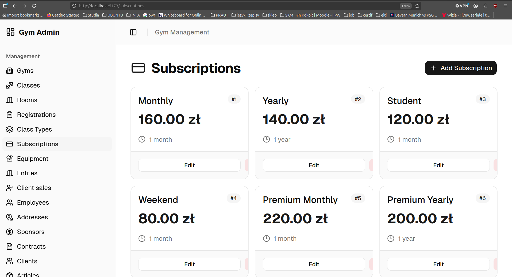
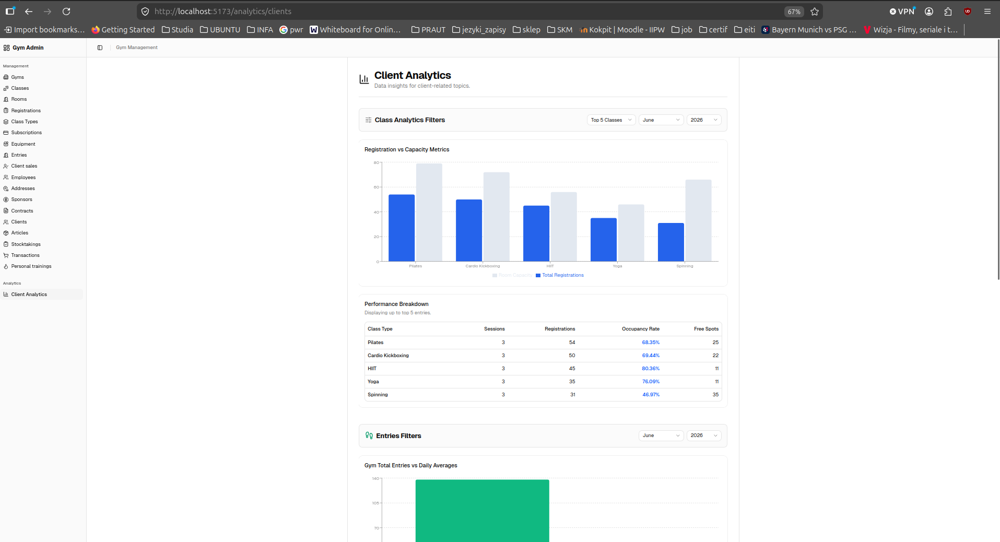
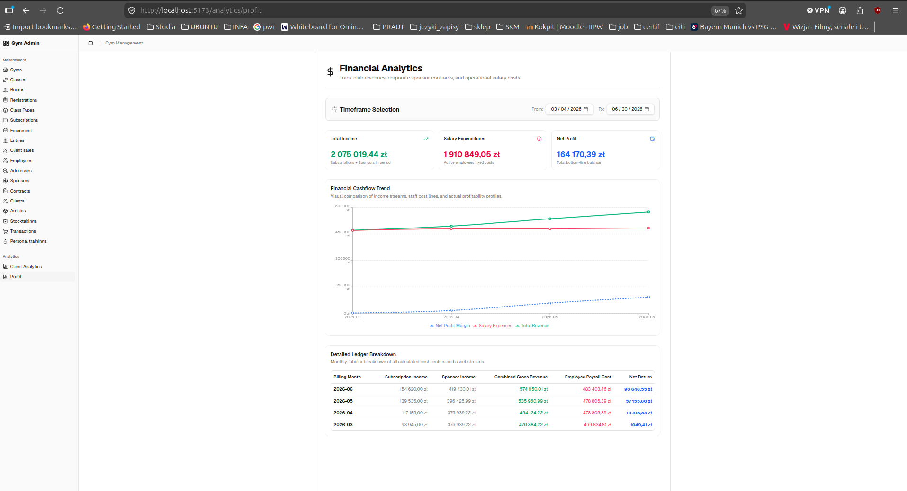

# BD2


## Authorzy
- Przemysław Twarowski
- Cezary Jankowski
- Maciej Krasoń
- Bartosz Paszkiewicz
- Marta Wiśniewska

## Spis treści

- [Etap 1](#etap-1)
- [Etap 2](#etap-2)
- [Etap 3](#etap-3)

---

## Uruchomienie środowiska

```bash
python3 -m venv venv
source ./venv/bin/activate
pip install -r backend/requirements.txt

# W głównym katalogu:
docker compose up --build

# uruchomienie wszystkich testów
docker compose -f docker-compose.test.yml run --rm backend_tests pytest -v
```

---

## Etap 1


**Temat:** System zarządzania siecią siłowni

**Opis projektu:** Projekt ma na celu stworzenie kompleksowego systemu bazodanowego wraz z aplikacją webową do obsługi sieci siłowni. System ułatwia zarządzanie wieloma placówkami, sprzętem sportowym, personelem (recepcjonistami, trenerami), harmonogramami zajęć fitness, treningami personalnymi oraz umowami sponsorskimi. Pozwala na ewidencję wejść na siłownię na podstawie ważnych karnetów, a także kontrolę stanów magazynowych artykułów sprzedawanych w recepcji.


### Technologie
Backend:Python(FastAPI)

DB:PostgreSQL

Frontend: React


## Etap 2

### Modele pojęciowe i logiczne bazy danych
Zaprojektowano strukturę w modelu relacyjnym, wykorzystując schematy tabel słownikowych (np. `class_type`, `room`), główne encje (np. `client`, `employee`, `gym`, `equipment`) i tabele asocjacyjne. Baza danych wykorzystuje model dziedziczenia m.in. dla sprzętu (tabela główna `equipment` oraz tabele zależne: `weight`, `machine`, `accessory`) oraz pracowników. Schemat uwzględnia powiązania takie jak wielokrotne przypisanie pracowników do siłowni, rejestracje na zajęcia, czy obsługę transakcji z koszykami wieloelementowymi. Główny diagram bazy danych znajduje się w lokalizacji `docs/etap1_model.png`.

### Prototyp aplikacji

#### Frontend
Zbudowany w oparciu o bibliotekę React z TypeScript oraz narzędzie Vite. Zapewnia interfejs (Single Page Application) do przeglądania i modyfikowania danych za pomocą interaktywnych tabel i formularzy.

#### Backend
Utworzony w języku Python (FastAPI). Realizuje podejście asynchroniczne i udostępnia zasoby przez architekturę REST API. Łączy się z bazą danych wykorzystując SQLAlchemy (ORM).

#### Baza danych
Wykorzystano PostgreSQL. W tej warstwie osadzono część logiki biznesowej projektu (np. kontrolę stanów magazynowych, walidację pojemności sal) za pomocą mechanizmów po stronie serwera bazy danych.

### Testy
- **Baza danych:** Walidacja zabezpieczeń wprowadzanych przez triggery — w tym próby obejścia ograniczeń wejścia (bramka), testy przepełnienia zajęć fitness, i sprawdzenie poprawności zmian w stanie magazynu.
- **Aplikacja:** Pakiety testów jednostkowych dla logiki modeli i schematów (Pydantic), oraz testy integracyjne endpointów REST weryfikujące poprawne dodawanie encji (klientów, placówek) z wykorzystaniem środowiska Docker-Compose (pytest).

---

### Procedury operacyjne

| Procedura | Opis |
|---|---|
| `add_subscriptions()` | Dodaje nową ofertę karnetu lub aktualizuje istniejącą |
| `add_equipment_base()` | Wstawia rekord do tabeli bazowej `equipment` |
| `add_weight()` | Obsługuje dodanie sprzętu typu ciężar |
| `add_machine()` | Obsługuje dodanie sprzętu typu maszyna |
| `add_accessory()` | Obsługuje dodanie sprzętu typu akcesorium |
| `add_client_subscription()` | Przypisuje karnet do klienta |
| `add_entry()` | Rejestruje wejście klienta na siłownię |
| `schedule_recurring_class()` | Automatyzuje harmonogramowanie zajęć cyklicznych |

> `add_equipment_base()`, `add_weight()`, `add_machine()` i `add_accessory()` tworzą hierarchię procedur — główna wstawia rekord do tabeli bazowej, a procedury szczegółowe uzupełniają odpowiednie tabele podrzędne.

---

### Procedury generujące dane

#### Zasoby bazowe
`generate_addresses()`, `generate_gyms()`, `generate_rooms()`, `generate_sponsors()`, `generate_subscriptions()`, `generate_articles()`

#### Ludzie
`generate_employees()`, `generate_receptionists()`, `generate_trainers()`, `generate_more_clients()`

#### Relacje i operacje
`generate_contracts()`, `generate_employees_gyms()`, `generate_trainers_classes()`, `generate_equipment()` (losuje typy sprzętu), `generate_classes()`, `generate_registrations()`, `generate_personal_training()`, `generate_transactions()` (tworzy koszyki zakupowe z artykułami)

#### Ruch
`generate_client_subscriptions()`, `generate_entries()` (tworzy historię wejść powiązaną z ważnymi karnetami)

---

### Triggery

| Trigger | Opis |
|---|---|
| `trg_check_duplicate_subscription` | Ochrona przed błędem klienta — zapobiega przypisaniu klientowi drugiego takiego samego, aktywnego karnetu |
| `trg_check_entry_subscription` | Kontrola dostępu (bramka) — przy próbie wejścia sprawdza, czy klient ma aktywny, opłacony karnet |
| `trg_check_entry_gym_hours` | Logika godzin otwarcia — blokuje rejestrację wejścia w godzinach, w których dana siłownia jest zamknięta |
| `trg_check_equipment_state` | Wymusza jednokierunkowe starzenie się sprzętu |
| `trg_check_capacity` | Zapisy na zajęcia — blokuje zapis na zajęcia fitness, jeśli limit miejsc został już osiągnięty |
| `trg_check_and_update_stock` | Obsługa magazynu (sklep) — przy każdym zakupie sprawdza, czy towar jest na stanie, i aktualizuje stan magazynowy |
| `trg_restore_stock` | Korekty transakcji — jeśli transakcja zostanie usunięta lub zaktualizowana, trigger automatycznie przywraca odpowiednią ilość sztuk do magazynu |
| `trg_check_contract_dates_validity` | Umowy sponsorskie — gwarantuje, że data wygaśnięcia umowy następuje po dacie jej zawarcia |
| `trg_check_overlapping_contracts` | Wyłączność sponsoringu — pilnuje, aby ta sama siłownia nie miała dwóch aktywnych umów z tym samym sponsorem w tym samym czasie |

---

### Funkcje raportowe

| Funkcja | Opis |
|---|---|
| `get_class_occupancy_pct(p_class_id)` | Zwraca procentowe zapełnienie konkretnych zajęć fitness |
| `get_transaction_total(p_transaction_client_id)` | Oblicza łączną kwotę do zapłaty za dany koszyk zakupowy w recepcji |
| `get_client_total_spent(p_client_id)` | Agreguje wszystkie historyczne zakupy klienta, wyliczając jego „wartość" dla biznesu |

---

## Etap 3

 Aplikacja frontendowa, backendowa i baza danych są w pełni zintegrowane i skonfigurowane w jednolitym środowisku uruchomieniowym (Docker Compose). Kod źródłowy jest udokumentowany, a definicje bazy danych zawierają szczegółowe komentarze.

### Opracowana baza danych i aplikacja
Dostarczono finalną wersję aplikacji oferującą dostęp do rozbudowanych formularzy i tabel umożliwiających podgląd, modyfikację i analizę danych biznesowych sieci siłowni. Baza danych posiada kompletny schemat z ponad 20 tabelami uwzględniającymi zoptymalizowane indeksy.

### Przeprowadzone testy i potencjalne wąskie gardła
Aplikację przetestowano za pomocą środowiska `pytest` w odizolowanym kontenerze Docker (przygotowano w pełni pokrywające przypadki użycia testy jednostkowe i integracyjne m.in. operacji CRUD i autoryzacji błędów).
**Potencjalne wąskie gardła:**
- Ze względu na intensywną historię odwiedzin (`entry`) oraz rejestracji na zajęcia (`class_registration`), przy bardzo dużym wolumenie danych baza mogłaby napotkać spowolnienia. Aby temu zapobiec, z powodzeniem zastosowano mechanizmy partycjonowania (`PARTITION BY RANGE`) dla najbardziej obciążonych tabel (np. rejestracje dzielone miesięcznie).
- Rozbudowane funkcje raportowe działające na historycznych transakcjach klientów przy braku regularnej archiwizacji mogą opóźniać czas ładowania widoków na frontendzie.



### Opracowane procedury i funkcje składowane
W systemie w pełni wdrożono zadeklarowane i wymienione w Etapie 2 procedury (np. `add_machine`, `add_client_subscription`) i funkcje wyzwalane przez triggery. Skrypty te operują bezpośrednio na bazie, zapewniając spójność procesów biznesowych (starzenie się sprzętu, weryfikacja godzin otwarcia przy wejściu, blokowanie rejestracji na zajęcia przy pełnym obłożeniu), co znacząco odciążyło warstwę backendową.

| Funkcja | Opis |
|---|---|
| `get_class_occupancy_pct(p_class_id)` | Zwraca procentowe zapełnienie konkretnych zajęć fitness |
| `get_transaction_total(p_transaction_client_id)` | Oblicza łączną kwotę do zapłaty za dany koszyk zakupowy w recepcji |
| `get_client_total_spent(p_client_id)` | Agreguje wszystkie historyczne zakupy klienta, wyliczając jego „wartość" dla biznesu |
| `get_popular_class_types(p_year, p_month, p_limit)` | Zwraca zestawienie najpopularniejszych typów zajęć w danym miesiącu i roku, zawierające m.in. liczbę rejestracji oraz średnie zapełnienie |
| `get_monthly_gym_entries(p_year, p_month)` | Generuje statystyki wejść do poszczególnych klubów w wybranym miesiącu, podając łączną liczbę wizyt oraz średnią dzienną |
| `get_subscription_counts(p_year, p_month)` | Zwraca zestawienie sprzedaży poszczególnych rodzajów karnetów w określonym miesiącu i roku, uporządkowane od najpopularniejszych |
| `get_financial_report(p_start_date, p_end_date)` | Generuje miesięczny raport finansowy dla podanego okresu, zestawiając przychody z karnetów i umów sponsorskich z kosztami wynagrodzeń oraz wyliczając zysk netto |

### Podsumowanie i dalsze kierunki rozwoju
Projekt pomyślnie implementuje działający system z kompleksową warstwą bazodanową. Dalsze kierunki rozwoju mogłyby uwzględniać:
- Przygotowanie aplikacji mobilnej dla klientów siłowni.
- Wpięcie zewnętrznych systemów płatności obsługujących odnawialne subskrypcje bezpośrednio w interfejsie transakcji.
- Rozszerzenie bazy o moduły dla użytkowników końcowych (osiągnięcia, wyzwania) by zwiększyć ich motywację i utrzymanie.


## Model Relacyjny

## BD2 Admin Gyms

## BD2 Admin Update

## BD2 Admin Delete

## BD2 Admin Edit

## BD2 Admin Sales

## BD2 Admin Subscriptions

## BD2 Admin Client Analytics

## BD2 Admin Profit Analytics



## Podział zadań
- Przemysław Twarowski -> implementacja do tabel subscriptions, entry, equipment "weight,machine,accessory", client-subscriptions. Testy jednostkowe i integracyjne
- Cezary Jankowski -> > implementacja tabel employee "receptionist, trainer",gym_employee, trainer_class, personal_training. Dodatkowo część analityczno-finansowa.
- Maciej Krasoń -> implementacja tabel class, class_type, registration, room. Dodatkowo część analityczna klienta.
- Bartosz Paszkiewicz -> implementacja tabel article,tranaction_article, client,transaction_client, stocktaking. Testy jednostkowe i integracyjne
- Marta Wiśniewska -> implementacja tabel address, gym, contract,sponsor. Testy jednostkowe i integracyjne
